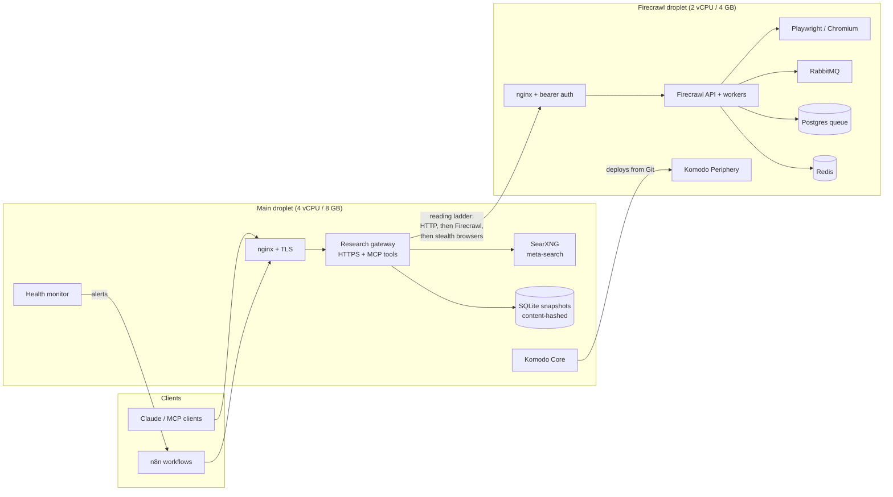

# Architecture: where this Firecrawl fork fits

This fork is one service in a self-hosted AI research platform that I designed and
run on DigitalOcean. This page explains the overall system, the decisions behind it
and how it is operated. Hostnames, IP addresses and credentials are deliberately
left out.

## System overview

## Request path

1. A client (Claude through MCP, or an n8n workflow) asks the research gateway a
   question.
2. The gateway queries **SearXNG** for candidate sources.
3. It reads the top pages through a **reading ladder** that escalates only as far
   as it needs to: a plain HTTP fetch first, then **Firecrawl** (JavaScript
   rendering and clean markdown), then stealth browsers for sites that block
   automation.
4. Page snapshots are stored with content hashes, so answers cite the exact text
   that was read, and a page can be questioned again later without refetching it.

## Design decisions

| Decision | Why |
|---|---|
| Firecrawl on its own droplet | Headless Chromium is the most memory-hungry, crash-prone part of the stack. Isolating it means a browser blow-up cannot take down search, the gateway or n8n. |
| Cheapest reader first | Most pages don't need a browser. Escalating only on failure keeps latency and memory down and avoids hammering sites. |
| Self-hosted rather than a SaaS scraper | No per-page cost, data stays on my infrastructure, and I can patch behaviour (e.g. [self-hosted `/map` discovery](../apps/api/src/lib/selfhost-map-discovery.ts)). |
| Komodo for deployment | Git-driven deploys of Docker Compose stacks across several hosts from one control plane, without the overhead of Kubernetes for a handful of services. |
| Memory limits on every container | Sized from measurements (about 1.85 GB idle and 2.2 GB peak for the whole Firecrawl stack during a 40-page crawl), so one service can't push the host into swap or the OOM killer. |
| Track upstream rather than diverge | Fork-specific changes are kept small and documented (see [`ops/README.md`](README.md)), so pulling upstream fixes stays a merge rather than a rewrite. |

## Operations

- **Deploys:** merge to `main`, build the changed images from Komodo's checkout, then
  redeploy with Komodo (its DeployStack does not rebuild images), and confirm the
  running images and deployed commit match `main`. Upgrades
  that change the topology have a written runbook with rollback steps
  ([`ops/README.md`](README.md)).
- **Verification:** [`ops/selfhost-smoke.sh`](selfhost-smoke.sh) checks the deployed
  API end to end (scrape, map, crawl, batch, search, error handling) after every
  deploy.
- **Monitoring:** scheduled health checks of both droplets, with alerts relayed
  through n8n.
- **Resilience:**
  - services restart automatically
  - logs are rotated
  - the browser service relaunches Chromium after a crash, single-flight so a
    burst of requests doesn't spawn several browsers
- **Security:**
  - the API listens on localhost only, behind nginx with TLS and bearer
    authentication
  - queue and cache services are not published outside the Docker network
  - secrets live in the deployment environment, never in Git

## Stack

Docker Compose · Komodo · nginx · DigitalOcean · Firecrawl (TypeScript/Node, Go,
Rust) · Playwright/Chromium · RabbitMQ · Postgres · Redis · SearXNG · n8n · MCP
